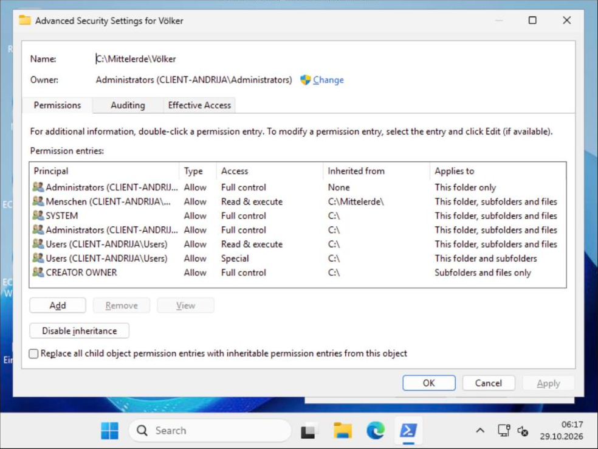
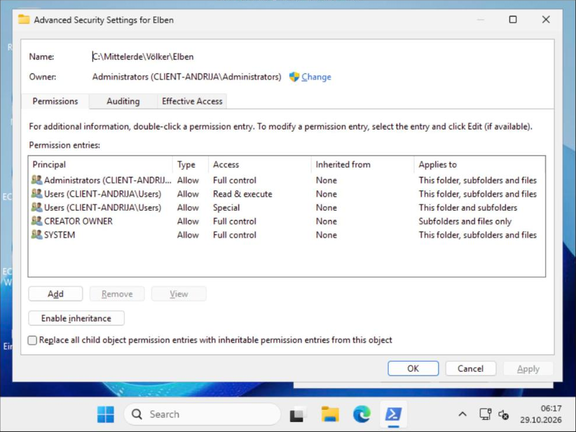
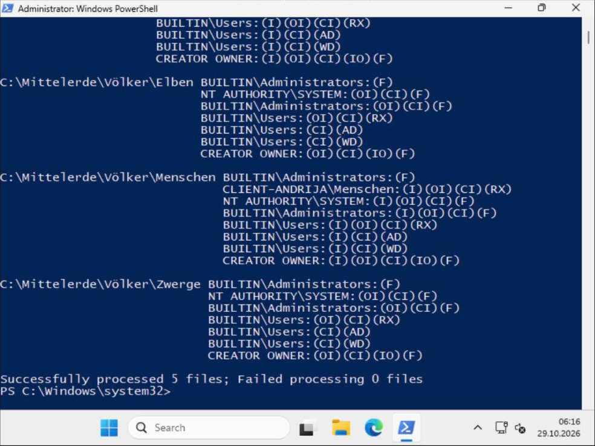

# Übung – Berechtigungen unter Windows (Mittelerde)

Praktisch nachvollzogen am 29.10.2026 auf `client-andrija` (Skript [`32-mittelerde.ps1`](../../scripts/32-mittelerde.ps1), lokale Gruppe `Menschen`). Ausgabe:

```
== 1) Menschen auf Mittelerde gesetzt -> alle Unterordner erben:
Mittelerde   ReadAndExecute, Synchronize geerbt=False
Völker       ReadAndExecute, Synchronize geerbt=True
Elben        ReadAndExecute, Synchronize geerbt=True
Menschen     ReadAndExecute, Synchronize geerbt=True
Zwerge       ReadAndExecute, Synchronize geerbt=True
== 2) Elben und Zwerge: Vererbung deaktivieren (konvertieren) und Menschen entfernen
Elben      Vererbung geschuetzt=True   Menschen vorhanden=False
Menschen   Vererbung geschuetzt=False  Menschen vorhanden=True
Zwerge     Vererbung geschuetzt=True   Menschen vorhanden=False
```

**Völker – Erweiterte Sicherheitseinstellungen:** Spalte *Inherited from* zeigt `C:\Mittelerde\` für „Menschen“ und `C:\` für die Standard-Einträge.



**Elben nach dem Deaktivieren der Vererbung:** Alle Einträge sind explizit (*Inherited from: None*), „Menschen“ ist entfernt, die Schaltfläche heisst jetzt *Enable inheritance*.



**icacls über den ganzen Baum:** `(I)` = geerbt. Bei Menschen ist `CLIENT-ANDRIJA\Menschen:(I)(OI)(CI)(RX)` geerbt, bei Elben und Zwerge fehlt der Eintrag, und es gibt kein `(I)` mehr.



```powershell
'C:\Mittelerde\Völker\Zwerge','C:\Mittelerde\Völker\Elben','C:\Mittelerde\Völker\Menschen' |
  ForEach-Object { New-Item -ItemType Directory -Path $_ -Force }
New-LocalGroup -Name Menschen          # auf dem Client (auf dem DC: New-ADGroup)
icacls C:\Mittelerde /grant 'Menschen:(OI)(CI)RX'
```

**Gruppe „Menschen“ auf Mittelerde – Änderungen bei Völker, Elben, Menschen, Zwerge?**
Alle Unterordner erhalten automatisch einen *geerbten* (grauen, nicht direkt editierbaren) Eintrag „Menschen“ mit denselben Rechten.

**Von wo erben Elben, Menschen, Zwerge?** Von `C:\Mittelerde\Völker` (ihrem direkten übergeordneten Ordner).
**Von wo erbt Völker?** Von `C:\Mittelerde`.
**Von wo erbt Mittelerde?** Vom Laufwerksstamm `C:\`.

**Vererbung bei Mittelerde deaktiviert – was ändert sich bei Völker?**
Nichts Sichtbares: Völker erbt weiterhin von Mittelerde. Nur Mittelerde selbst erbt nicht mehr von `C:\` (die Einträge wurden je nach Wahl in explizite umgewandelt oder entfernt – entsprechend erbt Völker nun diese).
**… bei Elben, Menschen, Zwerge?** Ebenfalls nichts – sie erben weiterhin über Völker von Mittelerde.

**Menschen bei Elben und Zwerge entfernen – was tun?**
Bei **Elben** und **Zwerge** jeweils die Vererbung deaktivieren (Erweitert → *Vererbung deaktivieren* → „Vererbte Berechtigungen in explizite Berechtigungen konvertieren“) und danach den nun expliziten Eintrag „Menschen“ entfernen.

**Die zwei Optionen beim Deaktivieren der Vererbung**
1. *Vererbte Berechtigungen in explizite Berechtigungen dieses Objekts konvertieren* – die bisherigen Einträge bleiben als direkte Einträge erhalten, man kann sie danach einzeln bearbeiten.
2. *Alle vererbten Berechtigungen aus diesem Objekt entfernen* – nur explizite Einträge bleiben; der Ordner ist ggf. für alle (ausser Besitzer) unzugänglich.

**Wo sieht man im GUI, von wo geerbt wird?**
Eigenschaften → Sicherheit → **Erweitert** → Spalte **„Geerbt von“** in der Liste der Berechtigungseinträge.

**Warum reicht es nicht, bei Mittelerde die Vererbung zu deaktivieren?**
Die Gruppe „Menschen“ wurde *auf* Mittelerde gesetzt, nicht von `C:\` geerbt. Das Deaktivieren der Vererbung auf Mittelerde unterbricht nur die Kette `C:\ → Mittelerde`; die Einträge von Mittelerde fliessen weiterhin nach unten. Man muss die Kette dort unterbrechen, wo der Eintrag entfernt werden soll (bei Elben und Zwerge).
