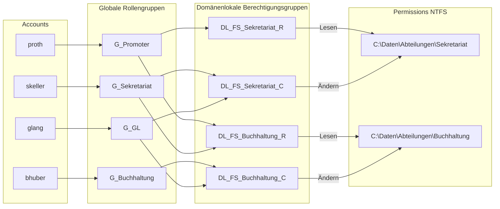

# Auftrag 04 – Freigaben, Laufwerke & Berechtigungen

Fragen: [fragen.md](fragen.md) · Skripte: [`04-benutzer-gruppen.ps1`](../../scripts/04-benutzer-gruppen.ps1), [`04-freigaben-ntfs.ps1`](../../scripts/04-freigaben-ntfs.ps1)
Übung „Berechtigungen unter Windows“: [../00-Einstieg/uebung-berechtigungen.md](../00-Einstieg/uebung-berechtigungen.md)

## 1. Benutzer und Gruppen

Benutzer gemäss Planung Kap. 8 (Kennwort interaktiv, nicht im Skript):

| Benutzer | Abteilung | Globale Gruppe | intern/extern |
|---|---|---|---|
| skeller (Sandra Keller) | Sekretariat | G_Sekretariat | G_Intern |
| bhuber (Beat Huber) | Buchhaltung | G_Buchhaltung | G_Intern |
| glang (Gabriel Lang) | GL | G_GL | G_Intern |
| proth (Paul Roth) | Promoter | G_Promoter | G_Extern |

`G_Intern` enthält die Gruppen G_Sekretariat, G_Buchhaltung, G_GL; `G_Extern` enthält G_Promoter (alle global, Typ Sicherheit).
Anmeldetest am Client mit je einem Benutzer (RDP über `GG_RDP_Users`).

## 2. UNC-Pfade

Aufbau: `\\<Server>\<Freigabe>\<Pfad>` – z. B. `\\dc-andrija.ec2.andrija.m159\Abteilungen\Buchhaltung`. Der Servername kann als NetBIOS-Name (`\\dc-andrija`), FQDN oder IP angegeben werden; `$` am Ende (z. B. `Software$`) blendet die Freigabe in der Netzwerkansicht aus.

## 3. Ordner, Freigaben, NTFS (grüne Zeilen der Matrix)

Freigabeberechtigung überall **Jeder = Ändern**, die eigentliche Steuerung erfolgt über NTFS. Vererbung ab `C:\Daten` deaktiviert, „Benutzer“/„Domänen-Benutzer“ entfernt, Administratoren + SYSTEM Vollzugriff. C = Ändern (Modify), R = Lesen & Ausführen.

| Physischer Pfad (DC) | Freigabe | LB | G_GL | G_Sekretariat | G_Buchhaltung | G_Promoter | G_Intern | G_Extern |
|---|---|---|---|---|---|---|---|---|
| C:\Daten | Daten | D: | C | – | C | – | – | – |
| C:\Daten\Pool | Pool | P: | C | C | C | C | – | – |
| C:\Daten\Abteilungen | Abteilungen | A: | C | R | R | R | – | – |
| …\Abteilungen\Sekretariat | | | C | C | – | R | – | – |
| …\Abteilungen\Buchhaltung | | | C | R | C | R | – | – |
| …\Abteilungen\Promoter | | | C | – | – | C | – | – |
| C:\Daten\Intern | Intern | I: | C | – | – | – | C | – |
| C:\Daten\Extern | Extern | E: | C | – | – | – | – | C |

Die Spalten Aussendienst, Partner, Informatik und Messemitarbeiter der Vorlage entfallen, weil diese Abteilungen in meiner Planung nicht existieren. `…\Abteilungen\GL` (nicht grün) wurde zusätzlich mit GL = C angelegt, damit die GL ein Abteilungslaufwerk hat (Auftrag 07).

Ausführung: `.\04-freigaben-ntfs.ps1 -Phase Matrix`

## 4. Berechtigungstests (als echter Benutzer, nicht als Admin)

| Test | Erwartung | Ergebnis |
|---|---|---|
| skeller (Sekretariat) liest `\\dc-andrija\Abteilungen\Buchhaltung` | Lesen ✔, Datei anlegen ✖ | ⏳ |
| glang (GL) schreibt in `\\dc-andrija\Pool` | Datei anlegen ✔ | ⏳ |
| proth (Promoter) öffnet „Aussendienst“ bzw. `\\dc-andrija\Intern` | Zugriff verweigert / nicht sichtbar (ABE) | ⏳ |

## 5. Access Based Enumeration

ABE blendet in einer Freigabe alle Ordner/Dateien aus, für die der Benutzer kein Leserecht hat. Ohne ABE sieht proth den Ordner „GL“ und erhält erst beim Öffnen „Zugriff verweigert“ – er weiss aber, dass es ihn gibt. Aktiviert für alle Freigaben: Server-Manager → Freigaben → Eigenschaften → Einstellungen → „Zugriffsbasierte Aufzählung aktivieren“ bzw. `Set-SmbShare -FolderEnumerationMode AccessBased`.

## 6. Eigenes Group-Nesting-Konzept (AGDLP)

Schwäche der Vorgabe: Berechtigungen hängen direkt an Rollengruppen. Kommt eine neue Abteilung dazu oder ändert sich ein Recht, muss man an den Ordner-ACLs arbeiten, und man sieht an der Gruppe nicht, welche Rechte sie hat.

**Neu nach AGDLP:** **A**ccount → **G**lobale Rollengruppe (G_‹Abteilung›) → **D**omänen**l**okale Berechtigungsgruppe pro Ressource und Recht (DL_FS_‹Ordner›_‹R|C›) → **P**ermission (nur DL-Gruppen stehen in den ACLs).

Namenskonvention: `G_` = global (Rolle), `DL_FS_<Ordner>_<R|C>` = domänenlokal (Fileserver-Recht).

| Berechtigungsgruppe (DL) | Ordner | NTFS | Mitglieder (globale Gruppen) |
|---|---|---|---|
| DL_FS_Sekretariat_C | Abteilungen\Sekretariat | Ändern | G_GL, G_Sekretariat |
| DL_FS_Sekretariat_R | Abteilungen\Sekretariat | Lesen | G_Promoter |
| DL_FS_Buchhaltung_C | Abteilungen\Buchhaltung | Ändern | G_GL, G_Buchhaltung |
| DL_FS_Buchhaltung_R | Abteilungen\Buchhaltung | Lesen | G_Sekretariat, G_Promoter |

Umgesetzt für die zwei Abteilungen **Sekretariat** und **Buchhaltung**: `.\04-freigaben-ntfs.ps1 -Phase AGDLP` (ersetzt die direkten Einträge der globalen Gruppen durch die DL-Gruppen). Ergebnis für Benutzer identisch, aber Rechteänderungen erfolgen künftig nur noch über Gruppenmitgliedschaften.

## 7. Nachweise

| Nachweis | Datei | Status |
|---|---|---|
| Benutzer + Gruppen in dsa.msc, Mitgliedschaften G_Intern/G_Extern | `images/04-gruppen.png` | ⏳ |
| Anmeldung eines Testbenutzers am Client | `images/04-login.png` | ⏳ |
| Freigaben inkl. ABE (Server-Manager) | `images/04-freigaben.png` | ⏳ |
| NTFS-Rechte (icacls bzw. Sicherheit-Tab) | `images/04-ntfs.png` | ⏳ |
| 3 Berechtigungstests | `images/04-test-*.png` | ⏳ |
| ABE: proth sieht nur erlaubte Ordner | `images/04-abe.png` | ⏳ |
| AGDLP-Gruppen + neue ACLs | `images/04-agdlp.png` | ⏳ |
