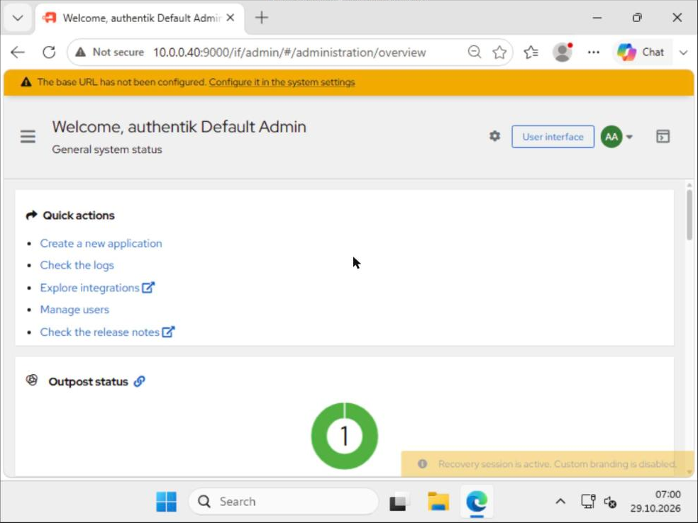
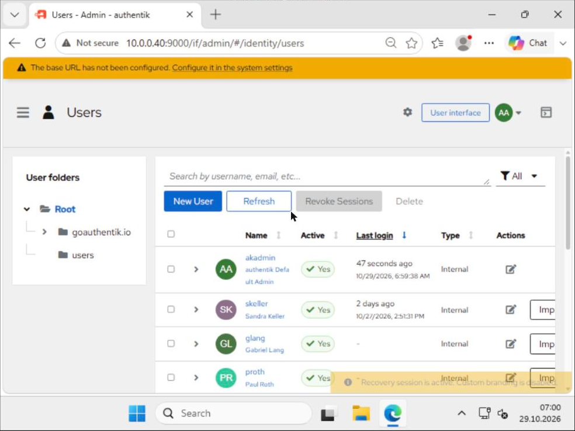
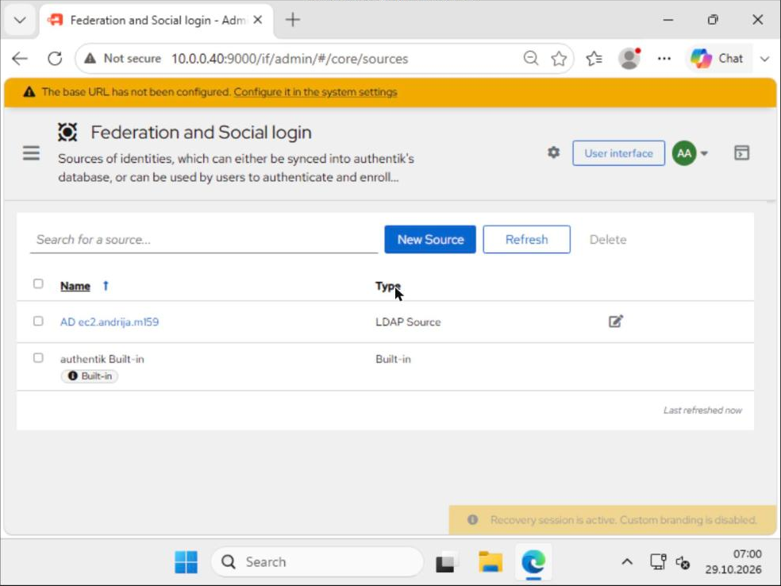
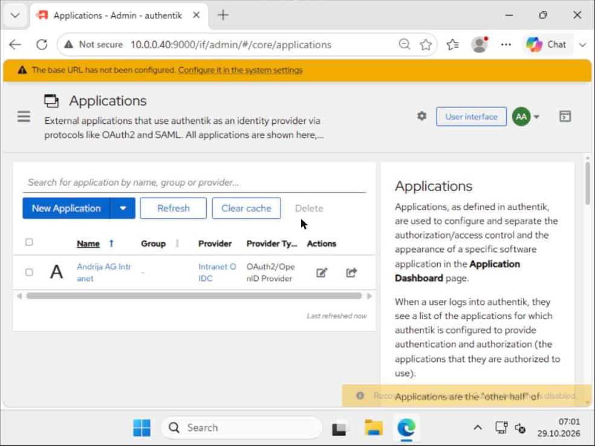
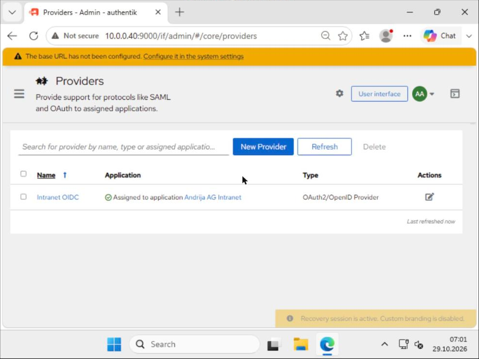
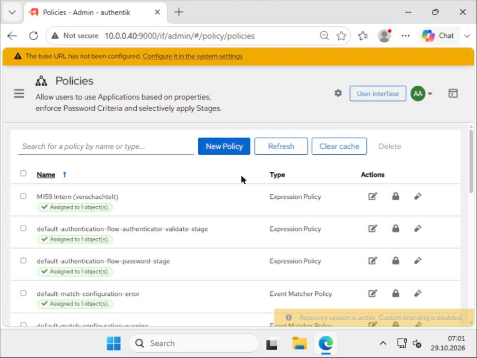

# Nachweis Auftrag 05 – Variante B: Authentik als moderner IdP am AD

Umgesetzt am 27.10.2026, vollständig per Skript und Authentik-API:
DC-Teil [`28-ldaps-authentik-dc.ps1`](../../scripts/28-ldaps-authentik-dc.ps1), IdP-Teil [`05b-authentik.sh`](../../scripts/05b-authentik.sh) (Phasen `install`, `token`, `config`, `test`), Ablauf [`run-05b.sh`](../../scripts/run-05b.sh).

**Warum Variante B:** AWS Managed Microsoft AD kostet im Learner Lab rund 18 $ pro Woche und hätte einen grossen Teil des Budgets verbraucht. Authentik zeigt dieselben Lernziele (externe Identitätsquelle, Vertrauen, LDAP vs. LDAPS, Authentifizierung vs. Autorisierung) und kostet nur eine kleine EC2-Instanz.

## Teil A – Bereitstellung

| Punkt | Umsetzung |
|---|---|
| Instanz | `idp-andrija` (i-05946d2d641358b4d), Ubuntu 24.04, t3.medium, 10.0.0.40, m159-public-1a |
| Security Group | `m159-sg-idp` **ohne Inbound-Regeln** – Verwaltung ausschliesslich über SSM, kein Port im Internet offen (strenger als die Planung mit 9443/MEINE-IP) |
| Authentik | 2026.8.5, Docker Compose (server, worker, postgresql) – alle `healthy` |
| Geheimnisse | PG-Passwort, Secret Key in `/opt/authentik/.env` (chmod 600); akadmin-Passwort und API-Token im SSM Parameter Store (`/m159/akadmin`, `/m159/ak_token`) |
| Namensauflösung | `docker-compose.override.yml`: `extra_hosts dc-andrija.ec2.andrija.m159 → 10.0.0.10` (Ubuntu nutzt den VPC-DNS, nicht den AD-DNS) |

## Teil B/C – LDAPS am DC und LDAP Source

**Zertifikat (Lab-Variante ohne Enterprise-CA):** Selbstsigniertes Serverzertifikat mit EKU *Server Authentication* im Computerspeicher des DC. Der DC verwendet es automatisch für LDAPS; geladen ohne Neustart über `renewServerCertificate` am RootDSE. Authentik vertraut genau diesem Zertifikat (importiert als *Verification Certificate*). Für Produktion: AD CS Enterprise-CA, dann bekommen alle DCs automatisch Zertifikate.

```
Subject    : CN=dc-andrija.ec2.andrija.m159
Thumbprint : 38445867CFA83829B9643AE5D99C25B9208781BE
NotAfter   : 27.10.2028
SAN        : DNS Name=dc-andrija.ec2.andrija.m159, DNS Name=dc-andrija, IP Address=10.0.0.10
EKU        : Server Authentication
== LDAPS-Test lokal (Port 636, TLS-Handshake)
TLS: Tls13  Zertifikat: CN=dc-andrija.ec2.andrija.m159
== Authentik: importiertes Verification Certificate
"name": "DC-LDAPS", "cert_subject": "CN=dc-andrija.ec2.andrija.m159", "cert_expiry": "2028-10-27T13:24:50Z"
```

**Bind-Konto:** `svc_authentik_ldap` in `OU=Dienstkonten`, nur Mitglied von *Domain Users* (Leserechte), Kennwort läuft nicht ab und kann nicht vom Benutzer geändert werden.

**LDAP Source `ad-ec2`:**

| Feld | Wert |
|---|---|
| Server URI | `ldaps://dc-andrija.ec2.andrija.m159:636` |
| Bind CN | `CN=svc_authentik_ldap,OU=Dienstkonten,OU=Andrija_AG,DC=ec2,DC=andrija,DC=m159` |
| Base DN | `OU=Andrija_AG,DC=ec2,DC=andrija,DC=m159` |
| User-Filter | `(&(objectClass=user)(!(objectClass=computer)))` |
| Gruppen-Filter | `(objectClass=group)`, Mitgliedschaft über `member`, eindeutig über `objectSid` |
| Mappings | authentik default LDAP + Active Directory Mappings (sAMAccountName, userPrincipalName, givenName, sn, mail, DN → Pfad) + eigenes Gruppen-Mapping `M159 Gruppe memberOf` |

**Synchronisierte Benutzer (Pfad = OU-Struktur aus dem AD):**

```
bhuber   goauthentik.io/sources/ad-ec2/Andrija_AG/Intern/Buchhaltung/Buchhaltung_Benutzer  G_Buchhaltung
glang    goauthentik.io/sources/ad-ec2/Andrija_AG/Intern/GL/GL_Benutzer                    G_GL, GG_RDP_Users
proth    goauthentik.io/sources/ad-ec2/Andrija_AG/Extern/Promoter/Promoter_Benutzer        G_Promoter
skeller  goauthentik.io/sources/ad-ec2/Andrija_AG/Intern/Sekretariat/Sekretariat_Benutzer  G_Sekretariat, GG_RDP_Users, G_Intranet_Users
svc_authentik_ldap / svc_fw_ldap  .../Andrija_AG/Dienstkonten
```

Synchronisierte Gruppen: alle G_*, DL_*, GG_RDP_* und 7-Zip aus `OU=Andrija_AG`.

## Login-Test (Authentifizierung gegen das AD)

Die Anmeldung läuft über den Standard-Flow von Authentik. Das Passwort wird **nicht in Authentik gespeichert**, sondern per LDAP-Bind am DC geprüft:

```
Passwort RICHTIG – nach Identifikation: ak-stage-password
Passwort RICHTIG – Ergebnis: xak-flow-redirect → "/"       Sitzung: skeller
Passwort FALSCH  – Ergebnis: ak-stage-password  "Invalid password"   Sitzung: keine
Ereignisse: 13:51:31 login skeller · 13:51:33 login_failed skeller
```

## Teil D – App per OIDC mit Autorisierung

| Objekt | Wert |
|---|---|
| Provider | `Intranet OIDC`, OAuth2/OIDC, confidential, Redirect `http://localhost:5000/callback` (strict), Signatur mit authentik Self-signed Certificate, Scopes openid/email/profile |
| Anwendung | `Andrija AG Intranet` (Slug `intranet-oidc`) |
| Discovery | Issuer `…/application/o/intranet-oidc/`, Endpunkte `authorize/`, `token/`, `userinfo/` |
| Policy | Expression Policy `M159 Intern (verschachtelt)`, an die Anwendung gebunden |

**Verschachtelte Gruppen:** Im AD sind die Abteilungsgruppen Mitglied von `G_Intern` (AGDLP-Struktur). Authentik übernimmt nur direkte Mitgliedschaften, deshalb hatte `G_Intern` dort 0 Mitglieder und ein einfaches Gruppen-Binding hat **alle** abgewiesen (erster Test: alle `passing:false`). Lösung: Das Gruppen-Mapping übernimmt `memberOf` jeder AD-Gruppe, und die Policy prüft, ob eine Gruppe des Benutzers `G_Intern` ist oder darin Mitglied ist.

```
G_Buchhaltung -> CN=DL_FS_Buchhaltung_C, CN=G_Intern
G_GL          -> CN=DL_FS_Buchhaltung_C, CN=DL_FS_Sekretariat_C, CN=G_Intern
G_Promoter    -> CN=DL_FS_Buchhaltung_R, CN=DL_FS_Sekretariat_R, CN=G_Extern
G_Sekretariat -> CN=DL_FS_Buchhaltung_R, CN=DL_FS_Sekretariat_C, CN=G_Intern

== Autorisierung pro Benutzer (check_access)
skeller {"passing":true}
bhuber  {"passing":true}
glang   {"passing":true}
proth   {"passing":false,"messages":["Kein Mitglied von G_Intern"]}
```

→ Interne Mitarbeitende erhalten Zugriff, der externe Promoter `proth` wird abgewiesen.

## Probleme und Lösungen

| Problem | Ursache | Lösung |
|---|---|---|
| API meldet `Token invalid/expired` | In Authentik 2026.8 hat der Bootstrap über Umgebungsvariablen weder `akadmin` als Superuser noch das Token angelegt | Phase `token`: akadmin + Gruppe *authentik Admins* (Superuser) + API-Token per `ak shell` gesetzt → API 200 |
| `ak ldap_sync` meldet `ResultMissing` | Befehl wartet nur kurz auf das Ergebnis der Hintergrundaufgabe | Sync läuft trotzdem im Worker weiter; Ergebnis wird über die API geprüft |
| Erster Login-Test ohne Sitzung | Flow-Executor antwortet mit 302, das Test-Skript ist der Weiterleitung nicht gefolgt | `curl -L` → `xak-flow-redirect` und Sitzung `skeller` |
| Alle Benutzer abgewiesen | verschachtelte Gruppen (siehe oben) | memberOf-Mapping + Expression Policy |
| LDAP-Signing (Server 2025) | `LDAPServerIntegrity = 1` auf dem DC; unsignierte Simple Binds sind unsicher (Klartext) | Nur LDAPS verwendet; Passwort-Rückschreiben ginge nur verschlüsselt |

## Weboberfläche (erledigt 29.10.2026)

Die Oberfläche bleibt aus dem Internet unerreichbar. Für die Aufnahmen wurde in `m159-sg-idp` **vorübergehend** TCP 9000 nur von `10.0.0.30` (wac-andrija) geöffnet und danach wieder entfernt. Die Anmeldung erfolgte ohne Kennworteingabe über einen einmaligen Wiederherstellungslink (`ak create_recovery_key 30 akadmin`, 30 Minuten gültig). Skript: [`run-gui6.sh`](../../scripts/run-gui6.sh).

| Ansicht | Bild |
|---|---|
| Admin-Übersicht (akadmin, Recovery-Sitzung) |  |
| Benutzer aus dem AD (skeller, glang, proth …) |  |
| Quelle `AD ec2.andrija.m159` (LDAP Source) |  |
| Applikation `Andrija AG Intranet` → Provider `Intranet OIDC` |  |
| Provider OAuth2/OpenID, zugewiesen |  |
| Policy `M159 Intern (verschachtelt)` (Expression, gebunden) |  |

Der Hinweis „base URL has not been configured“ ist für das Lab unkritisch, weil kein externer Hostname verwendet wird.
