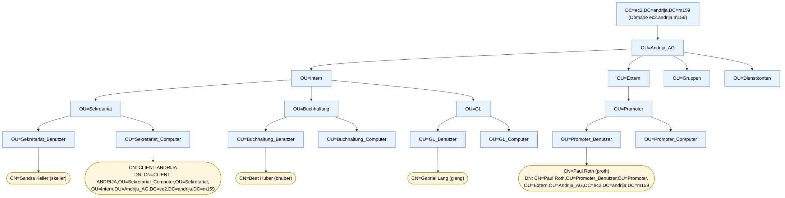

# Auftrag 07 – Directory Information Tree & Gruppenrichtlinien

Fragen: [fragen.md](fragen.md) · Skripte: [`07-dit.ps1`](../../scripts/07-dit.ps1), [`07-gpos.ps1`](../../scripts/07-gpos.ps1) · Diagramm-Quelle: [dit.mmd](dit.mmd)

## 1. DIT

Richtlinien erfüllt:
- Jede Abteilung kommt genau einmal als OU vor (Sekretariat, Buchhaltung, GL, Promoter).
- **Intern/Extern** ist eine eigene Ebene unter `OU=Andrija_AG`.
- Eindeutige Namen (`Sekretariat_Benutzer` statt mehrfach `Benutzer`).
- Letzte Ebene trennt immer Benutzer- und Computerkonten.
- Zusätzlich `OU=Gruppen` und `OU=Dienstkonten`, damit Gruppen/Dienstkonten nicht von Benutzer-GPOs getroffen werden.

| Objekt | DN |
|---|---|
| Benutzer proth | `CN=Paul Roth,OU=Promoter_Benutzer,OU=Promoter,OU=Extern,OU=Andrija_AG,DC=ec2,DC=andrija,DC=m159` |
| Computer client-andrija | `CN=CLIENT-ANDRIJA,OU=Sekretariat_Computer,OU=Sekretariat,OU=Intern,OU=Andrija_AG,DC=ec2,DC=andrija,DC=m159` |

Umsetzung im AD: `.\07-dit.ps1` (OUs mit Schutz vor versehentlichem Löschen, Benutzer/Client/Gruppen verschieben).

## 2. Gruppenrichtlinien

Namenskonvention (Kap. 5.4): `<U|C>_<Wirkungsbereich>_<Zweck>` – U = Benutzerkonfiguration, C = Computerkonfiguration.
`.\07-gpos.ps1` erstellt die GPOs, Verknüpfungen, Filter und GPP-Einträge; geprüft und ergänzt wird in der GPMC (Screenshots).

### Teil 1 – Passwortrichtlinie (Default Domain Policy)

GPMC → Default Domain Policy → Bearbeiten → Computerkonfiguration → Richtlinien → Windows-Einstellungen → Sicherheitseinstellungen → Kontorichtlinien → Kennwortrichtlinien:
- *Kennwort muss Komplexitätsvoraussetzungen entsprechen* → **Deaktiviert**
- *Maximales Kennwortalter* → **0** (läuft nie ab)

Nur diese Einstellungen werden geändert. Kontorichtlinien wirken für Domänenkonten nur auf Domänenebene, deshalb nicht in einer OU-GPO. Prüfung: `Get-ADDefaultDomainPasswordPolicy`.

### Teil 2 – Netzlaufwerke (Verknüpfung auf OUs, keine Zielgruppenadressierung)

| GPO | Verknüpft mit | Laufwerk |
|---|---|---|
| U_Andrija_AG_Laufwerk_Pool | OU=Andrija_AG | P: → `\\dc-andrija.ec2.andrija.m159\Pool` |
| U_Intern_Laufwerk_Intern | OU=Intern | I: → `\\…\Intern` |
| U_Extern_Laufwerk_Extern | OU=Extern | E: → `\\…\Extern` |
| U_Sekretariat_Laufwerk_Abteilung | OU=Sekretariat_Benutzer | A: → `\\…\Abteilungen\Sekretariat` |
| U_Buchhaltung_Laufwerk_Abteilung | OU=Buchhaltung_Benutzer | A: → `\\…\Abteilungen\Buchhaltung` |
| U_GL_Laufwerk_Abteilung | OU=GL_Benutzer | A: → `\\…\Abteilungen\GL` |
| U_Promoter_Laufwerk_Abteilung | OU=Promoter_Benutzer | A: → `\\…\Abteilungen\Promoter` |

(Benutzerkonfiguration → Einstellungen → Windows-Einstellungen → Laufwerkszuordnungen, Aktion *Aktualisieren*, wiederherstellen.)

### Teil 3 – Desktop-Verknüpfung Web-CRM, positive Sicherheitsfilterung

GPO `U_Andrija_AG_Verknuepfung_CRM`, verknüpft auf oberster Ebene (`OU=Andrija_AG`), Verknüpfung `%DesktopDir%\Web-CRM` → `https://crm.webapp.ch`.
Sicherheitsfilterung: *Authentifizierte Benutzer* entfernt aus „Übernehmen“ (bleibt nur „Lesen“ in der Delegierung – seit MS16-072 nötig, sonst kann der Computer die GPO nicht lesen), **G_Intern** hinzugefügt. Test: skeller erhält den Link, proth nicht.

### Teil 4 – WMI-Filter

- WMI-Filter `WMI_Nur_Windows10`: `SELECT * FROM Win32_OperatingSystem WHERE Version LIKE "10.%" AND ProductType = "1"` (Kap. 4.3; ProductType 1 = Client-OS, deckt Win10 und Win11 ab).
- GPO `U_Promoter_Textdatei_kopieren`, verknüpft mit `OU=Promoter`, WMI-Filter zugewiesen.
- Dateien-Einstellung: Quelle `\\dc-andrija.ec2.andrija.m159\Pool\WMI-Filter.txt` → Ziel `%TempDir%\WMI-Filter.txt` (Dateiname im Ziel), Register *Allgemeine Optionen*: **Im Sicherheitskontext des angemeldeten Benutzers ausführen**.
- Export: `gpresult /h gpo.html` als proth → [gpo.html](gpo.html).
- Erwartung in meiner Umgebung: Der Client ist ein Windows **Server** (ProductType 3) → Filter ergibt *falsch*, gpresult zeigt die GPO unter „Verweigerte GPOs – WMI-Filter“. Das belegt, dass der Filter wirkt. Zur Gegenprobe wird der Filter testweise auf `ProductType = "3"` geändert → Datei erscheint in `%TEMP%`.

### Teil 5 – Drucker

Zwei fiktive Drucker (Treiber *Microsoft PS Class Driver*, Ports 10.0.0.201 / 10.0.0.202) auf dem DC: **Drucker_Farbe** (Standardwert Farbe) und **Drucker_SW** (Standardwert Schwarzweiss) über Erweitert → *Standardwerte* gesetzt, beide freigegeben.
GPO `U_Andrija_AG_Drucker` verteilt `\\dc-andrija.ec2.andrija.m159\Drucker_Farbe` und `…\Drucker_SW` (Freigegebener Drucker, Aktion *Aktualisieren*).
Test per Video: Drucker am Client löschen → `gpupdate /force` → Drucker erscheinen wieder (`images/07-drucker.mp4`).

### Teil 6 – MSI-Verteilung 7-Zip

- Freigabe `\\dc-andrija.ec2.andrija.m159\Software$` (Jeder: Lesen, NTFS Jeder/Authentifizierte Benutzer: Lesen), `7z…-x64.msi` darin.
- GPO `C_Domain_Software_7-Zip` (Computerkonfiguration → Richtlinien → Softwareeinstellungen → Softwareinstallation → Neu → Paket per **UNC-Pfad** → *Zugewiesen*), verknüpft mit der Domäne.
- Sicherheitsgruppe **7-Zip** (enthält `client-andrija`).
- Hinweis: Die Softwareinstallation selbst bietet keine Zielgruppenadressierung (Item-Level-Targeting gibt es nur in den Einstellungen/Preferences). Die Einschränkung auf die Gruppe 7-Zip erfolgt deshalb über die **Sicherheitsfilterung** der GPO (Authentifizierte Benutzer nur Lesen, 7-Zip Lesen + Übernehmen).
- Bei Fehler `%%1274`: Client 2× neu starten (Softwareinstallation nur beim Start) bzw. Leserecht „Jeder“ auf der Freigabe.
- Nachweis: Ereignisanzeige → Anwendung → Quelle *Application Management Group Policy* / *MsiInstaller* Ereignis 1033/11707 „Installation erfolgreich“.

## 3. Nachweise

| Nachweis | Datei | Status |
|---|---|---|
| OUs in dsa.msc (Kontrolle graphisches DIT) | `images/07-ous.png` | ⏳ |
| Passwortrichtlinie | `images/07-pw.png` | ⏳ |
| GPMC-Übersicht aller GPOs/Verknüpfungen | `images/07-gpmc.png` | ⏳ |
| Laufwerke bei skeller / proth | `images/07-laufwerke-*.png` | ⏳ |
| CRM-Link bei intern, nicht bei extern | `images/07-crm.png` | ⏳ |
| gpo.html (WMI-Filter) | `gpo.html` | ⏳ |
| Drucker-Video | `images/07-drucker.mp4` | ⏳ |
| 7-Zip installiert, Eventlog | `images/07-7zip-event.png` | ⏳ |
