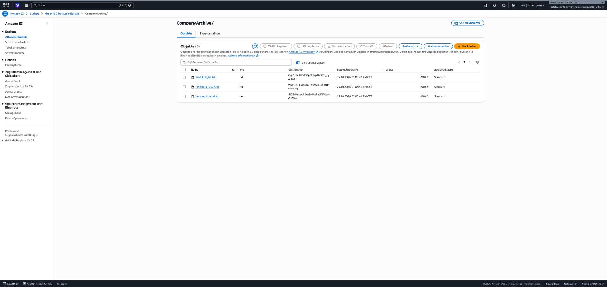

# Nachweis Auftrag 12 – Variante B: Hybrid Backup mit AWS S3

Umgesetzt am 27.10.2026 auf `dc-andrija` per SSM Run Command (Skript [`19-s3-backup-test.ps1`](../../scripts/19-s3-backup-test.ps1), ruft [`12b-Sync-ToCloud.ps1`](../../scripts/12b-Sync-ToCloud.ps1) und [`12b-Restore-FromCloud.ps1`](../../scripts/12b-Restore-FromCloud.ps1) auf).

## Setup

| Punkt | Umsetzung / Ergebnis |
|---|---|
| Bucket | `tbz-m159-backup-milosevic`, us-east-1 |
| Block Public Access | alle vier Optionen `True` |
| Versionierung | `Enabled` (gelöschte/überschriebene Dateien bleiben als ältere Version erhalten) |
| Zugriff | Instanzrolle **LabRole** über `LabInstanceProfile` – keine Access Keys auf dem Server (im Learner Lab sind keine IAM-User erlaubt) |
| AWS CLI | AWS CLI v2 (MSI, still installiert), Region `us-east-1` |
| Archiv | `C:\CompanyArchive\` mit `Rechnung_2026.txt`, `Vertrag_KundeA.txt`, `Protokoll_GL.txt` |

## Teil A – Sync und Automatisierung

```
== aws s3 ls (Verbindungstest)
2026-10-27 01:48:37 m159-andrija-scripts-463057933533
2026-10-27 13:04:28 tbz-m159-backup-milosevic
== Sync
2026-10-27T13:06:41 Start Sync C:\CompanyArchive -> s3://tbz-m159-backup-milosevic/CompanyArchive
upload: ..\CompanyArchive\Protokoll_GL.txt  to s3://tbz-m159-backup-milosevic/CompanyArchive/Protokoll_GL.txt
upload: ..\CompanyArchive\Rechnung_2026.txt to s3://tbz-m159-backup-milosevic/CompanyArchive/Rechnung_2026.txt
upload: ..\CompanyArchive\Vertrag_KundeA.txt to s3://tbz-m159-backup-milosevic/CompanyArchive/Vertrag_KundeA.txt
2026-10-27T13:06:43 Ende (ExitCode 0)
== Geplante Aufgabe
Task      : M159-S3-Backup
State     : Ready
User      : SYSTEM
Intervall : PT15M
Aktion    : powershell.exe -NoProfile -ExecutionPolicy Bypass -File C:\Scripts\12b-Sync-ToCloud.ps1
```

Die Aufgabe läuft als **SYSTEM** (unabhängig von einer Benutzeranmeldung) alle **15 Minuten** und schreibt ein Protokoll nach `C:\Scripts\s3-sync.log`.



## Teil B – Disaster Recovery

```
== Disaster Recovery: Datei loeschen
Vorhanden nach Loeschen: False
== Restore
download: s3://tbz-m159-backup-milosevic/CompanyArchive/Rechnung_2026.txt to ..\CompanyArchive\Rechnung_2026.txt
FullName      : C:\CompanyArchive\Rechnung_2026.txt
Length        : 50
Inhalt: Rechnung 2026-001, Kunde Muster AG, CHF 4'250.00
```

Die gelöschte Datei wurde vollständig und mit identischem Inhalt aus S3 wiederhergestellt.

## Hinweis Fehler & Korrektur

Beim zweiten Aufruf mit `-Registrieren` aus `C:\Scripts` versuchte das Skript, sich selbst auf sich selbst zu kopieren (`Cannot overwrite the item … with itself`). Die Aufgabe wurde trotzdem korrekt registriert; das Skript prüft jetzt den Pfad vor dem Kopieren.

## Offen (interaktiv)

- Screenshot Aufgabenplanung (`taskschd.msc` → `M159-S3-Backup`, Verlauf) beim nächsten RDP-Login.


## Aufgabenplanung (Bildschirmfoto)

