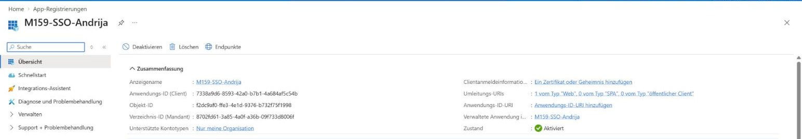
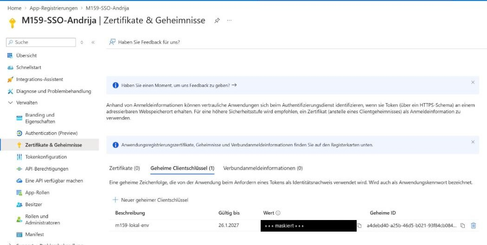
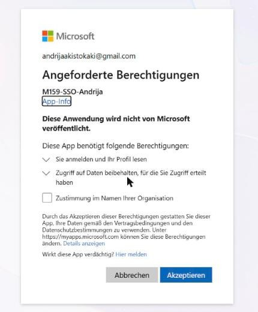
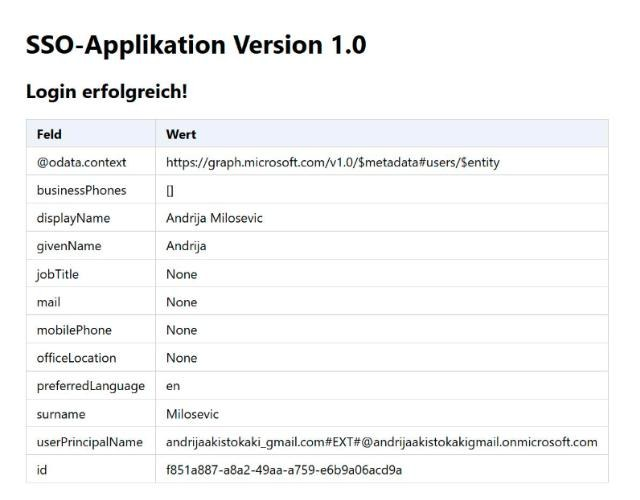

# Nachweis Auftrag 13 – Variante A: SSO-Python-App mit Microsoft Entra ID

Umgesetzt am 28.10.2026 im eigenen Entra-Mandanten **Standardverzeichnis** (Konto `andrijaakistokaki@gmail.com`, Entra ID Free).

## 1. App-Registrierung

| Punkt | Wert |
|---|---|
| Name | `M159-SSO-Andrija` |
| Kontotypen | Nur ein Mandant (Standardverzeichnis) |
| Umleitungs-URI | **Web** `http://localhost:5000/callback` |
| Anwendungs-ID (Client) | `7338a9d6-8593-42a0-b7b1-4a684af5c54b` |
| Verzeichnis-ID (Mandant) | `8702fd61-3a85-4a0f-a36b-09f733d8006f` |
| Berechtigung | Microsoft Graph `User.Read` (delegiert) |
| Geheimer Clientschlüssel | `m159-lokal-env`, 90 Tage (gültig bis 26.1.2027) |

Client-ID und Mandanten-ID sind keine Geheimnisse. Der **Secret-Wert** steht nur in der lokalen `sso-python-app/.env` auf dem Laptop. Die Datei ist per `.gitignore` ausgeschlossen (`git check-ignore` geprüft). Auf dem Bildschirmfoto ist er geschwärzt.

## 2. App starten (Laptop)

`sso-python-app/start-app.cmd` (Doppelklick):
1. installiert Python 3.12 per `winget` (Benutzerbereich), falls es fehlt,
2. legt ein `venv` an und installiert `requirements.txt`,
3. startet `app.py` → `Running on http://localhost:5000` (Log: `start.log`, ebenfalls ignoriert).

## 3. Login-Test

1. `http://localhost:5000` → Weiterleitung auf `login.microsoftonline.com/<Mandant>/oauth2/v2.0/authorize?...redirect_uri=http://localhost:5000/callback&scope=User.Read`
2. Konto `andrijaakistokaki@gmail.com` auswählen. Der Browser hatte bereits eine Entra-Sitzung, deshalb kam **kein Kennwort-Prompt**.
3. Einmalige Einwilligung *„Sie anmelden und Ihr Profil lesen“* (User.Read) → Akzeptieren

4. Callback → Code gegen Token getauscht → Graph `/me` → **„Login erfolgreich!“**

5. **SSO-Test (Test B):** App erneut aufrufen. Nach der Kontoauswahl erscheint die Profilseite direkt, ohne Kennwort und ohne Consent. Grund: Das Session-Cookie von `login.microsoftonline.com` wird wiederverwendet (token-basiertes SSO).

## Auswertung

- Ablauf: OAuth 2.0 Authorization Code Flow. Die App bekommt nie ein Kennwort, nur einen Code. Diesen tauscht sie serverseitig mit Client-ID und Secret gegen ein Access-Token für Microsoft Graph.
- Der UPN `andrijaakistokaki_gmail.com#EXT#@…onmicrosoft.com` zeigt: Das Gmail-Konto ist ein externes Microsoft-Konto, das als Gast bzw. Besitzer im Mandanten angelegt ist.
- Redirect-URI muss **exakt** `localhost` sein (mit `127.0.0.1` → AADSTS50011).
- Test C (Edge/PRT am hybrid-joined Client) setzt Entra Connect voraus (Auftrag 10A). Dieser wurde mit Variante B umgesetzt, deshalb entfällt Test C.
