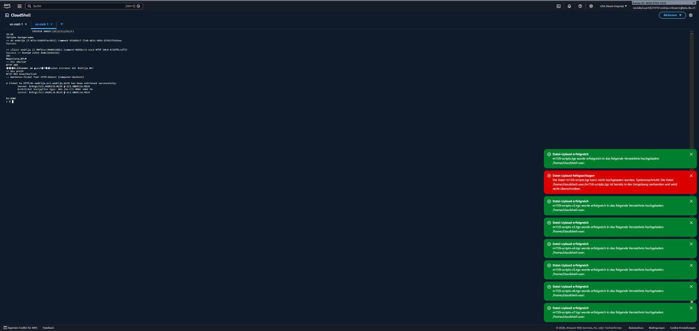

# Nachweis Auftrag 13 – Variante B: IIS mit Windows-Authentifizierung (Kerberos)

Umgesetzt am 27.10.2026 über SSM Run Command (Skripte: [`13b-iis-kerberos.ps1`](../../scripts/13b-iis-kerberos.ps1), [`18-iis-fix.ps1`](../../scripts/18-iis-fix.ps1), Test: [`17-test-iis.ps1`](../../scripts/17-test-iis.ps1)).

## Konfiguration (dc-andrija)

| Punkt | Wert |
|---|---|
| Rollen | Web-Server, Web-Windows-Auth, Web-Url-Auth |
| Anonyme Authentifizierung | **False** |
| Windows-Authentifizierung | **True** (Negotiate → Kerberos, Fallback NTLM) |
| Autorisierung (web.config) | `<clear/>` + `Allow roles="EC2\G_Intranet_Users"` |
| Gruppe | `G_Intranet_Users` (OU=Gruppen), Mitglied: skeller |
| Intranet-Zone | GPO `U_Andrija_AG_Intranetzone` (Site-zu-Zonen-Zuweisung → Browser sendet Kerberos automatisch) |
| Security Group | `m159-sg-dc`: TCP 80 nur aus `10.0.0.0/16` (VPC-intern) |

## Test vom Client (client-andrija)

```
== Anonym (ohne Anmeldedaten)
401
Negotiate,NTLM
== Als skeller
HTTP 200
Willkommen im geschützten Intranet der Andrija AG!
== Als proth
HTTP 401 Unauthorized
== Kerberos-Ticket fuer HTTP-Dienst (Computer-Kontext)
A ticket to HTTP/dc-andrija.ec2.andrija.m159 has been retrieved successfully.
KerbTicket Encryption Type: AES-256-CTS-HMAC-SHA1-96
```



## Auswertung

- Ohne Anmeldung antwortet der Server mit **401** und bietet `Negotiate` (Kerberos) an → Anonymzugriff gesperrt.
- **skeller** (Mitglied `G_Intranet_Users`) erhält **200** und die Seite → Authentifizierung *und* Autorisierung erfolgreich.
- **proth** ist gültig angemeldet, aber nicht in der Gruppe → **401** → Autorisierung greift.
- Der KDC stellt ein Service-Ticket für `HTTP/dc-andrija.ec2.andrija.m159` aus (AES-256) → Kerberos-SSO funktioniert; der SPN wird über `HOST/` des Computerkontos abgedeckt.

## Behobene Probleme

1. **HTTP 0 / Timeout**: Port 80 war in `m159-sg-dc` nicht offen → Regel TCP 80 aus 10.0.0.0/16 ergänzt.
2. **proth bekam 200**: Die Serverebene erbt `Allow users="*"`. Lösung: `<clear/>` in der web.config der Site.

## Browser-SSO (erledigt 28.10.2026)
Bildschirmfoto Edge als skeller ohne Kennwortabfrage: [GUI-Nachweise](../GUI-Nachweise.md#auftrag-13-b--browser-sso-kerberos)
